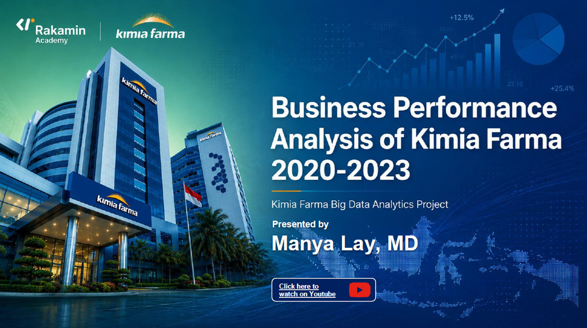

# Kimia Farma Big Data Analytics Project

## Business Performance Analysis 2020-2023

Rakamin Academy x Kimia Farma Big Data Analytics Project

---

## 📌 Project Overview

This project analyzes Kimia Farma's business performance from 2020-2023 using pharmaceutical transaction data.

The objective is to generate business insights through data analysis and visualization to support data-driven decision making.

---

## 🎯 Project Objectives

- Analyze pharmaceutical business performance
- Explore transaction and sales trends
- Identify key business insights
- Create visualization for performance monitoring

---

## 🛠️ Tools & Technologies

- SQL
- BigQuery
- Google Looker Studio
- Data Analytics

---

## 📊 Project Preview

---

## SQL Analysis

The SQL queries used for this project are available here:

[View SQL Analysis File](./query_tabel_analisa_kimia_farma.sql)

---

## 📈 Key Insights

- Analyzed pharmaceutical business performance from 2020–2023.
- Evaluated sales trends, transaction patterns, and business performance indicators.
- Built analytical queries to support data-driven decision-making.
- Created visualization for performance monitoring.

---

## 🔄 Project Workflow

1. Data exploration
2. Data preparation
3. SQL analysis
4. Business performance evaluation
5. Dashboard visualization
6. Insight generation

---

## 📊 Dashboard Preview

---

## 📊 Dashboard

View the interactive dashboard:

[Google Looker Studio Dashboard](https://datastudio.google.com/reporting/5f3ce684-ffff-409b-9d80-b61e5ba2cb81/page/p_1qmd4nor5d)

---

## 📈 Key Analysis Areas

- Revenue performance analysis
- Transaction analysis
- Product/business performance evaluation
- Regional or operational insights

---

## 💡 Key Skills Demonstrated

- SQL querying
- Big Data analytics
- Business intelligence
- Data visualization
- Pharmaceutical industry analytics

---

## Skills Demonstrated

- SQL Data Analysis
- BigQuery
- Healthcare / Pharmaceutical Analytics
- Business Intelligence
- Data Visualization
- Dashboard Development

---

## 👤 Author

Dr. Manya Lay
